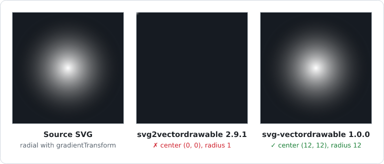

# svg-vectordrawable

[](https://www.npmjs.com/package/svg-vectordrawable)
[](https://www.npmjs.com/package/svg-vectordrawable)
[](https://github.com/IBRAHIMDANS/svg-vectordrawable/actions/workflows/ci.yml)
[](https://codecov.io/gh/IBRAHIMDANS/svg-vectordrawable)
[](https://www.npmjs.com/package/svg-vectordrawable)
[](LICENSE)

Convert SVG to **Android VectorDrawable** XML — robustly, across SVGs from any editor.

Built on [svgo](https://github.com/svg/svgo) (v4) for parsing and normalization, with a hand‑written
walker that emits the VectorDrawable. Notably handles **gradients including `gradientTransform`**
(linear & radial), which the popular but unmaintained `svg2vectordrawable` gets wrong.

**[Try it online](https://ibrahimdans.github.io/svg-vectordrawable/)**: paste or drop an SVG, get the
XML, the warnings and a side-by-side preview, nothing to install.



_Same SVG ([`radial-gradient-transform.svg`](test/fixtures/radial-gradient-transform.svg)), rendered
with resvg: the source, the `svg2vectordrawable` 2.9.1 output and the `svg-vectordrawable` output.
Regenerated at each release by [`docs/assets/generate-comparison.mjs`](docs/assets/generate-comparison.mjs)._

```
npm i svg-vectordrawable
```

## Why another one?

`svg2vectordrawable` is unmaintained (last release 2022), depends on `svgo@^2.8`, and ignores
`gradientTransform` (Figma radial gradients render at the wrong place). This library is on
`svgo@4`, bakes `gradientTransform` into the Android coordinates, and **fails loud** instead of
emitting plausible‑but‑wrong output.

## Usage

```ts
import { convert } from 'svg-vectordrawable';

const { xml, warnings, minSdk } = convert(svgString, {
    optimize: true, // run svgo normalization first (recommended)
    currentColor: '#000', // value substituted for `currentColor`: a CSS color or an Android reference (see below)
    colorMap: { '#1A73E8': '@color/brand' }, // SVG colors → Android color references
    floatPrecision: 3,
    fillBlackForUnfilled: true, // unfilled paths get black (SVG default)
    xmlTag: false, // prepend <?xml ...?>
    tint: '#FFFFFFFF', // android:tint on <vector> (Android color literal)
    autoMirrored: false, // true: android:autoMirrored="true" (flipped in right-to-left layouts)
    width: 24, // android:width in dp (viewport unchanged); alone, the height follows the aspect ratio
    height: 24, // android:height in dp; both set with another ratio stretch the drawing
    strict: false, // true: throw on lossy and approximated output; 'lossy': only on lossy output
    minSdk: 21, // warn (`min-sdk-exceeded`) when the output needs a higher API level
    rules: {}, // per-code severity, overrides `strict` (see below)
    onWarn: (w) => console.warn(w.code, w.message),
});
```

`convert` is synchronous and returns `{ xml, warnings, minSdk }`. `minSdk` is the Android API level the
output needs: 24 when it uses gradients or `fillType="evenOdd"`, otherwise 21.

### Theme colors (`currentColor` and `colorMap`)

`currentColor` also accepts an Android color reference, emitted as is in `android:fillColor` /
`android:strokeColor` so the icon follows the app theme (dark mode included): `?attr/colorOnSurface`,
`?android:attr/colorAccent`, `@color/icon`, `@android:color/white`, with an optional `package:`
prefix (`@com.example.lib:color/icon`). `colorMap` maps literal SVG colors to such references:

```ts
convert(svg, {
    currentColor: '?attr/colorOnSurface',
    colorMap: { '#1A73E8': '@color/brand', red: '?attr/colorError' },
});
```

- Keys are any CSS color, compared after normalization to `#AARRGGBB`: `#f00`, `red` and `rgb(255,0,0)`
  are the same key (two keys for one color with different references throw).
- A reference carries no alpha: `fill-opacity`, `stroke-opacity` and `opacity` go to `fillAlpha` /
  `strokeAlpha` as usual. The color's own alpha too: an exact `#AARRGGBB` key wins, otherwise an opaque
  key matches its color at any alpha, e.g. `rgba(26,115,232,0.5)` with the map above gives
  `@color/brand` and `android:fillAlpha="0.502"` (the reference's own alpha is multiplied by Android).
- Gradient stops (`<item android:color>`, checked with `aapt2 link`) get the reference when opaque. An
  `<item>` has no alpha, so a translucent stop keeps its literal color (black for a `currentColor`
  reference) and is reported as `unsupported-paint`.
- Only `currentColor` and `colorMap` produce references: a `fill="@color/x"` written in the SVG is not
  copied. A malformed reference (`?colorPrimary`, `@color/1x`, `@drawable/x`…) throws a `TypeError`.
- The resources must exist in the app (`aapt2 link` fails on an unknown `@color/…` or `?attr/…`).
  `vectorDrawableToSvg` draws them in gray unless `colors` maps them (e.g. `{ '?attr/colorPrimary': '#6750A4' }`, Android `#AARRGGBB` literals); `onUnresolvedColor` reports the missing ones.

### Preview

`vectorDrawableToSvg` turns a VectorDrawable back into SVG, to preview the result in a browser or a PR:

```ts
import { convert, vectorDrawableToSvg } from 'svg-vectordrawable';
const preview = vectorDrawableToSvg(convert(svg).xml, { density: 2, applyTint: true });
```

### Warnings, errors and `rules`

Every construct that cannot be converted faithfully emits a warning with a stable `code` (listed in
the exported `WARNING_CODES`). Each code has a category (exported `WARNING_CATEGORIES`): **lossy**
(content lost or wrong), **approximation** (rendering slightly differs) or **info** (Android lint
style, API level). `strict: true` turns lossy and approximation warnings into errors, `strict: 'lossy'`
only lossy ones; info warnings are never raised by `strict`. `rules` sets the severity per code
(`'off' | 'warn' | 'error'`) and wins over `strict`. Errors are thrown as a
`ConversionError` carrying the offending `warning`, so you can fall back (e.g. to a PNG, which the
CLI does with [`--fallback-png`](#png-fallback)):

```ts
import { convert, ConversionError } from 'svg-vectordrawable';

try {
    // Reject anything lossy, but accept approximated group opacity.
    const { xml } = convert(svg, { strict: true, rules: { 'opacity-approximated': 'warn' } });
} catch (err) {
    if (err instanceof ConversionError) console.log('cannot convert:', err.warning.code);
    else throw err;
}
```

| Code                           | Meaning                                                                                                 |
| ------------------------------ | ------------------------------------------------------------------------------------------------------- |
| `unsupported-element`          | `<text>`, `<image>`, `<foreignObject>`, `<switch>` — skipped                                            |
| `unsupported-attribute`        | non-clip `mask`, `filter`, `marker*`, `vector-effect`, `paint-order`, `arcs` joins — ignored            |
| `unsupported-stroke-dasharray` | dash pattern that cannot be resolved (`em`/`ex` units) — drawn solid                                    |
| `unsupported-stroke-gradient`  | no longer emitted (gradient strokes are supported); kept for compatibility                              |
| `unsupported-paint`            | `<pattern>` paint (fallback color or black); translucent stop mapped to a reference                     |
| `unsupported-style`            | CSS left in a `<style>` that could not be applied to elements — ignored                                 |
| `unsupported-clip-path`        | `objectBoundingBox` clip, evenodd clip with crossing contours, unconvertible content                    |
| `gradient-approximated`        | radial focal point; elliptical radial on a path that also has a solid stroke                            |
| `opacity-approximated`         | opacity folded onto overlapping children / fill+stroke — overlaps look darker                           |
| `missing-gradient`             | `url(#id)` paint, no fallback: pointing at nothing (black fill) or at an invalid gradient (not painted) |
| `missing-clip-path`            | `clip-path` pointing at nothing — ignored                                                               |
| `group-skew`                   | skewed `<g>` baked into path geometry                                                                   |
| `gradient-under-skew`          | gradient placement under a baked skew is approximate                                                    |
| `gradient-bbox-unavailable`    | `objectBoundingBox` gradient without a measurable path box                                              |
| `empty-path`                   | shape without geometry — skipped                                                                        |
| `min-sdk-exceeded` (info)      | the output needs a higher API level than the `minSdk` option                                            |
| `large-vector` (info)          | `android:width`/`height` above 200 dp (Android lint `VectorRaster`)                                     |
| `long-path-data` (info, off)   | a `pathData` longer than 800 characters (lint `VectorPath`); enable it with `rules`                     |

Node file helpers:

```ts
import { convertFile, convertDir } from 'svg-vectordrawable';
convertFile('icon.svg', 'res/drawable/icon.xml');
convertDir('svg/', 'res/drawable/');
convertDir('svg/', 'res/drawable/', {}, { androidNames: true }); // valid Android resource names
```

### CLI

```
svgvd icon.svg                 # writes icon.xml next to it
svgvd icons/ -o out/           # batch a directory
svgvd icon.svg --stdout        # print to stdout
svgvd -s '<svg>…</svg>'        # convert an inline SVG string
svgvd icon.svg --xml-tag --tint '#FFFFFFFF'
svgvd icon.svg --current-color '?attr/colorOnSurface' --color-map '#1A73E8=@color/brand'   # theme colors (repeatable map)
svgvd icon.svg --strict        # fail on anything not representable
svgvd icon.svg --strict --rule opacity-approximated=warn   # per-code severity
svgvd icon.svg --strict=lossy  # fail only when content would be lost
svgvd icon.svg --min-sdk 21    # warn when the output needs a higher API level
svgvd arrow.svg --auto-mirrored --width 24   # RTL mirroring, 24dp wide (height follows the ratio)
svgvd icons/ -o res/drawable/ --android-names   # Arrow-Left.svg → arrow_left.xml (valid resource names)
cat icon.svg | svgvd > icon.xml   # stdin → stdout (also `svgvd -`, or `svgvd - -o icon.xml`)
svgvd icons/ -r -o out/        # recursive: icons/a/b.svg → out/a/b.xml
svgvd icons/ -o out/ --json    # JSON report on stdout, for CI (see below)
svgvd icons/ -r --dry-run      # convert and report, write nothing
svgvd icons/ -o res/drawable --strict --fallback-png all   # PNGs for what cannot be a vector
```

`--json` prints one entry per file, `[{ input, output, warnings, minSdk, error, fallback }]`, and nothing else on
stdout (human-readable lines stay on stderr). Each warning carries its `code` and `category`
(`lossy`, `approximation`, `info`); `error` is `null` or `{ message, code?, category? }` (`code` when a
warning was escalated by `--strict` / `--rule`). The XML then has to go to files: `--json` is refused
with `--stdout`, or with stdin / `-s` without `-o file.xml`, unless `--dry-run`. The exit code is 1
when any file fails, as without `--json`. `fallback` is `null`, or `{ outputs, reason }` for a file
rendered to PNG (below): `output` is then `null`, and `reason` is the warning that rejected it.

With `--recursive` and `--android-names`, the outputs are written flat into `-o` (an Android resource
directory has no subdirectories) and a name collision across subdirectories fails before anything is
written. Symbolic links to directories are not followed. Without an input argument, `svgvd` reads
stdin only when it is not a terminal, and prints the help when nothing is piped.

#### PNG fallback

`<filter>`, `<text>`, a gray `<mask>`… will never be a VectorDrawable. With `--fallback-png <densities>`,
a file that the conversion **rejects** (`--strict`, `--strict=lossy` or `--rule <code>=error`) is
rendered to PNG instead, one per density bucket, and its XML is not written:

```
svgvd icons/ -o app/src/main/res/drawable --android-names --strict --fallback-png all
# blur.svg → res/drawable-{mdpi,hdpi,xhdpi,xxhdpi,xxxhdpi}/blur.png, the others → res/drawable/*.xml
```

`<densities>` is `all` or a comma list of `mdpi,hdpi,xhdpi,xxhdpi,xxxhdpi` (1×, 1.5×, 2×, 3×, 4×). The
PNG has the size the `<vector>` would have had in dp (`--width` / `--height` included) times the
density, rendered by [resvg](https://github.com/linebender/resvg). It goes to `drawable-<density>/` in
the directory of the XML, or beside it when that directory is named `drawable`. A file that converts,
even with warnings, never gets a PNG; an invalid SVG still fails. The renderer is an optional
dependency, loaded only when a fallback is needed: `npm install @resvg/resvg-js`.

The same renderer is exported by the Node API (ESM and CommonJS, not the browser builds):

```ts
import { convert, ConversionError, renderFallbackPng, DENSITIES, type Density } from 'svg-vectordrawable';

try {
    writeFileSync('res/drawable/blur.xml', convert(svg, { strict: true }).xml);
} catch (err) {
    if (!(err instanceof ConversionError)) throw err;
    for (const density of Object.keys(DENSITIES) as Density[])
        writeFileSync(`res/drawable-${density}/blur.png`, renderFallbackPng(svg, { density }));
}
```

`renderFallbackPng(svg, { density, width, height })` returns a PNG `Buffer`: `density` is one of the
`DENSITIES` keys (default `'mdpi'`), `width` / `height` are in dp as for `convert`. It throws on an
invalid SVG or option, and with a one-line `npm install @resvg/resvg-js` message when the renderer is
not installed.

### Browser

A browser build (svgo's browser bundle, no Node built-ins) is published under the `./browser`
subpath:

```ts
import { convert } from 'svg-vectordrawable/browser';
const { xml } = convert(svgString);
```

`svg-vectordrawable/browser-lite` is the same API without svgo (68 KB instead of 625 KB for the minified
IIFE build): conversion always runs with `optimize: false`, so `<style>` CSS is not inlined and
shapes are converted as authored. The [online playground](https://ibrahimdans.github.io/svg-vectordrawable/)
runs on this build, so its output can differ from the CLI on SVGs that rely on `<style>`.

## What it handles

| Feature                                                                                                                                                   | Status |
| --------------------------------------------------------------------------------------------------------------------------------------------------------- | ------ |
| Paths, `fill`, `stroke` (width/cap/join/miter), `fill-rule` → `fillType`                                                                                  | ✅     |
| Shapes (`rect`/`circle`/`ellipse`/`line`/`poly*`) → path                                                                                                  | ✅     |
| Colors: `#rgb[a]`, `#rrggbb[aa]`, `rgb()/rgba()`, `hsl()/hsla()`, named, `currentColor`                                                                   | ✅     |
| Attribute inheritance (incl. presentation attrs on the `<svg>` root and `<g>`)                                                                            | ✅     |
| Inline `style="…"` and `<style>` (via svgo)                                                                                                               | ✅     |
| Linear & radial **gradients**, `gradientTransform`, **`objectBoundingBox`** (via path bbox), `href` sharing, `spreadMethod` → `tileMode`                  | ✅     |
| `<g transform>` → `<group>` (translate/rotate/scale); **skew/shear baked into geometry**                                                                  | ✅     |
| **`<use>` / `<symbol>`** references — inlined before conversion                                                                                           | ✅     |
| `clip-path` → `<clip-path>` (on shapes and `<g>`, incl. `<use>` / transformed clip content)                                                               | ✅     |
| `opacity` folded into `fillAlpha`/`strokeAlpha` (root `<svg>` opacity → exact `android:alpha`)                                                            | ✅     |
| `viewBox` origin, `preserveAspectRatio` (meet / slice / none), nested `<svg>`, `<a>`, `display` / `visibility`, units (`px`/`in`/`cm`/`mm`/`pt`/`pc`/`%`) | ✅     |

## Known limitations

A VectorDrawable simply cannot represent some SVG features. These are **warned** (or throw in
`strict` mode), never silently mis‑rendered:

- `<filter>`, `<pattern>`, `<image>`, `<text>` — not representable (the CLI can render such files to
  PNG: [`--fallback-png`](#png-fallback)). A `<mask>` is converted to a
  `<clip-path>` when it is clip-equivalent (opaque white content, or opaque content with `mask-type: alpha`);
  any other mask (gray, translucent, stroked, gradient…) is warned with the reason.
- `stroke-dasharray` in font-relative units (`em`, `ex`) — the stroke is drawn solid. Other dash
  patterns are baked into the path geometry (VectorDrawable has no native dashes).
- Radial gradients are circles in VectorDrawable. Elliptical radials (non-uniform `gradientTransform`,
  `objectBoundingBox` on a non-square shape) are made exact by drawing the fill inside a `<group>`
  carrying the ellipse's deformation; they stay approximated only when the same path also has a solid
  stroke (it would be distorted). Focal points (`fx`/`fy`) are approximated (`gradient-approximated`).
- CSS that svgo cannot inline (`@media`, `:hover`, complex selectors) — `unsupported-style`.
- `gradientUnits="objectBoundingBox"` is resolved from the path's bounding box; only when that box
  is unavailable does it fall back to the viewport (with a warning).
- `filter`, `marker-*`, non-clip `mask` references and `clipPathUnits="objectBoundingBox"` — warned, not applied.
- Group `opacity` has no VectorDrawable equivalent: it is folded onto each child, which is exact only
  when the children do not overlap (`opacity-approximated` otherwise).

## Robustness

- **Icon corpus in CI** (`scripts/corpus.mjs`): 9,251 icons (Feather, Bootstrap Icons, Heroicons,
  Tabler, pinned versions) converted with and without svgo on every push — zero exceptions, zero
  warnings required.
- **Android toolchain**: the fixtures (gradients, `gradientTransform`, `objectBoundingBox`, `<use>`,
  sheared groups, clip-path, nested transforms) are **compiled and linked with `aapt2`** against
  `android.jar`, so attribute names and values are validated, not just XML well-formedness.
- **Visual regression**: every fixture is rendered with resvg next to its VectorDrawable and must match
  within 1% of inked pixels (`pnpm test:visual`).
- **Android's own renderer**: the generated VectorDrawables are drawn by layoutlib (Android's Skia/hwui,
  through Paparazzi on the JVM) and compared with the source SVG (`pnpm run validate:android`; needs a
  full JDK 17+ and the Android SDK).
- **Golden snapshots** lock the exact XML against regressions.

## Documentation

- [Migrating from `svg2vectordrawable`](docs/migration-from-svg2vectordrawable.md)
- [Integrations](docs/integrations.md) (Node scripts, React Native icons, Gradle, Vite/webpack, CI)
- Build plugins / MCP server: [Gradle plugin](integrations/gradle-plugin/README.md), [Vite plugin](integrations/vite-plugin/README.md), [MCP server](integrations/mcp-server/README.md), [Figma plugin](integrations/figma-plugin/README.md) (not published yet; [overview](docs/integrations.md#plugins-and-mcp-server))
- [Comparison with `svg2vectordrawable` and Android Studio's Svg2Vector](docs/comparison.md)

## License

MIT
